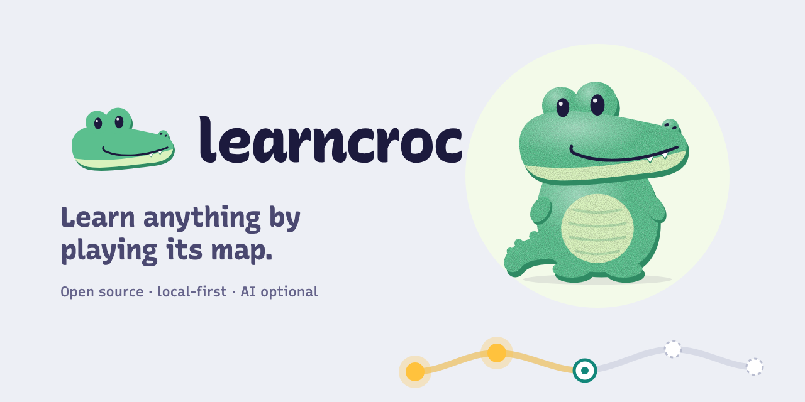

<p align="center">
  <picture>
    <source media="(prefers-color-scheme: dark)" srcset="brand/assets/readme-banner-dark.png">
    
  </picture>
</p>

<h3 align="center">Paste a link. Get a map. Learn it by playing.</h3>

<p align="center">
  Free and open source. Runs on your machine. No account, no tracking, AI optional.
</p>

<p align="center">
  <a href="#try-it-in-two-minutes"><b>Try it</b></a> ·
  <a href="#the-croc">Meet the croc</a> ·
  <a href="#why-it-sticks">Why it sticks</a>
</p>

---

You saved the article. You watched the video. A week later you can't explain any of it.

Learncroc fixes that. Give it a link, some text or a subject, and it draws the topic as a **map of short
stops**. Each stop asks you a question first, teaches you just enough to answer it, has you play with the
idea, and closes by answering the question you guessed at. Every few stops a short checkpoint opens the next
part of the map.

Finishing a map feels like finishing a good short game: you were curious, you got a few things wrong, and now
you can explain the topic to a friend.

## What you get

- **Any link becomes a course.** Paste a blog post, a paper or docs page and get a map of 3 to 12 stops built
  from the source's own words.
- **Hand-made maps, ready to play.** *How LLMs work* is a full map; *Bayesian thinking* and *Color theory* are
  short samplers. They work with no AI key at all.
- **You do, not just read.** Every card asks you to guess, drag, sort or predict. Cards are short: a few
  minutes each.
- **It stays learned.** Lit stops fade over days and come back in a two-minute Relight, scheduled with FSRS,
  the spaced-repetition algorithm behind modern Anki.
- **Yours, on your machine.** Progress lives in `~/.learncroc`. Nothing is uploaded. Bring your own model key
  if you want the AI parts.

## The croc


The croc walks you through every map. Ask it to explain a card another way, give an example or go deeper,
and it answers about exactly what's on your screen. During a checkpoint it only hints, because getting the
answer handed to you doesn't teach you anything.

It grins when you get it right. When you don't, it leans in and looks at the card with you: no red, no X,
no telling off. It turns gold for a moment when a stop lights up, and that is the only time it's gold.

## Why it sticks

Each part of the loop comes from learning research, not from what looks busy:

| Learncroc does | Because |
|---|---|
| Asks you to guess before it teaches | A wrong guess you care about makes the right answer stick (pretesting, hypercorrection) |
| Makes you use each idea, not reread it | Retrieving beats rereading (the testing effect) |
| Brings stops back just as they fade | Spaced review keeps knowledge for months |
| Mixes an earlier idea into each checkpoint | Interleaving helps you tell ideas apart |
| Tests on situations the cards never showed | Using an idea somewhere new is the real test of understanding |

## Try it in two minutes

You need [Bun](https://bun.sh) 1.2 or later.

```sh
git clone https://github.com/learncroc/learncroc.git
cd learncroc
bun install
bun dev
```

Open <http://localhost:5173>, pick a map from the Library, and play the first stop. To build a map from any
link, add a model key in Settings and paste the link.

Learncroc is early (v0.1), and it changes every week.

## Like where this is going?

**Star the repo** to follow along. It's the simplest way to help: stars help other people find Learncroc.

Found something confusing, or want a map for a topic you care about? [Open an issue](https://github.com/learncroc/learncroc/issues).

<p align="center"><sub>Code: MIT. First-party maps: CC BY-SA 4.0.</sub></p>
